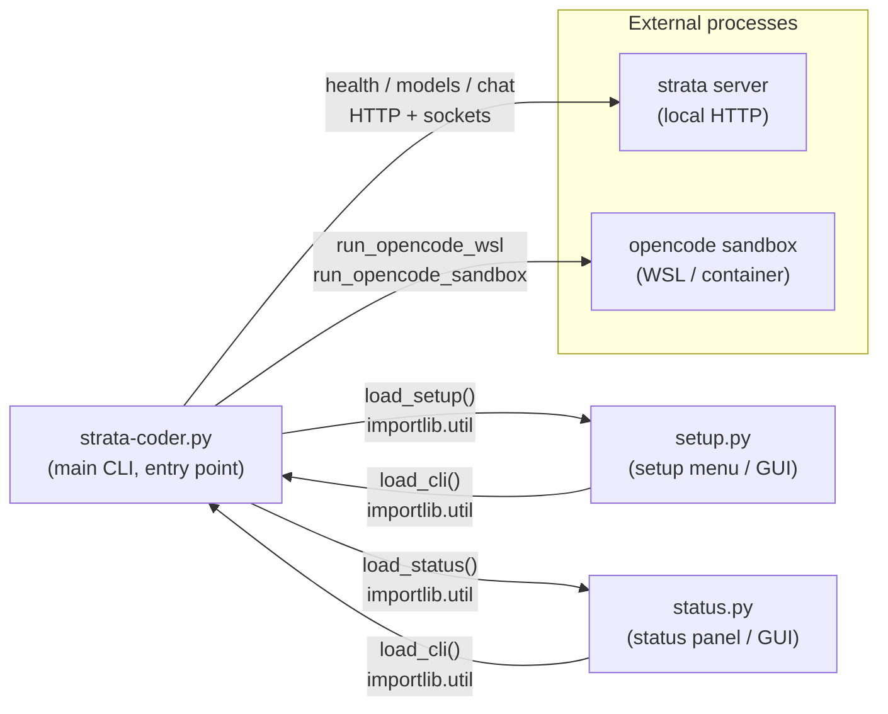
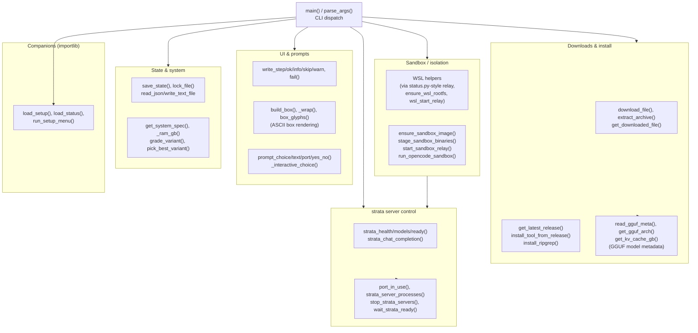
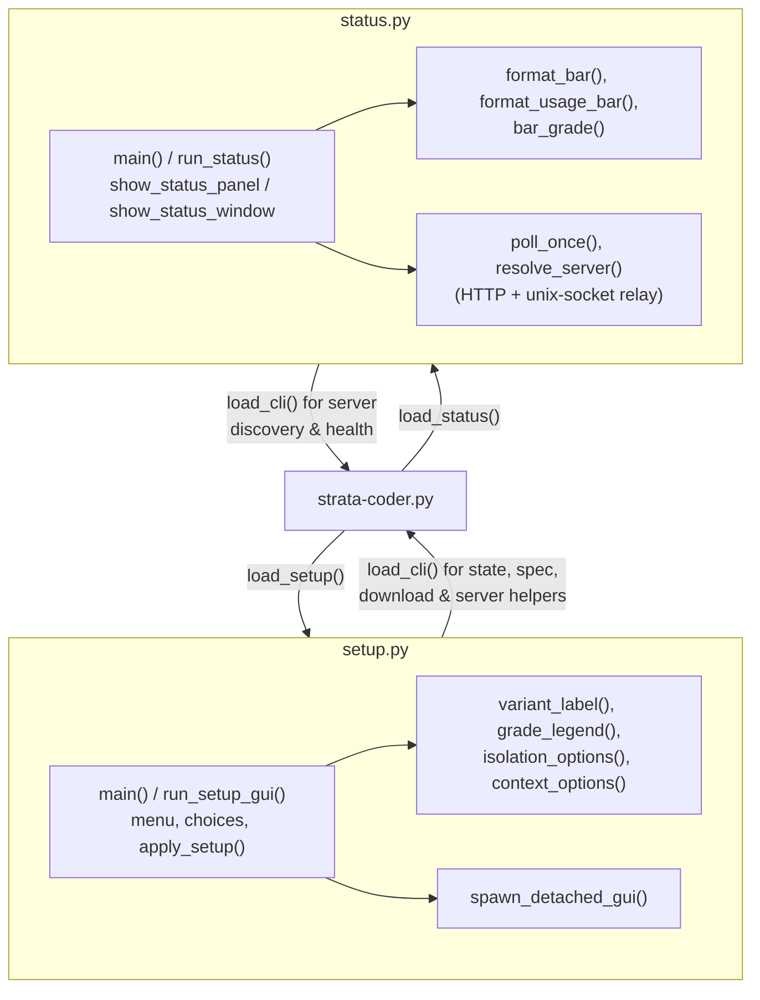

# strata_coder — Code Structure

View with VS Code built-in Markdown preview (`Ctrl+Shift+V`). No extensions required.

## Module Relationships

## Inside strata-coder.py (main module)

## setup.py / status.py (companion modules)

